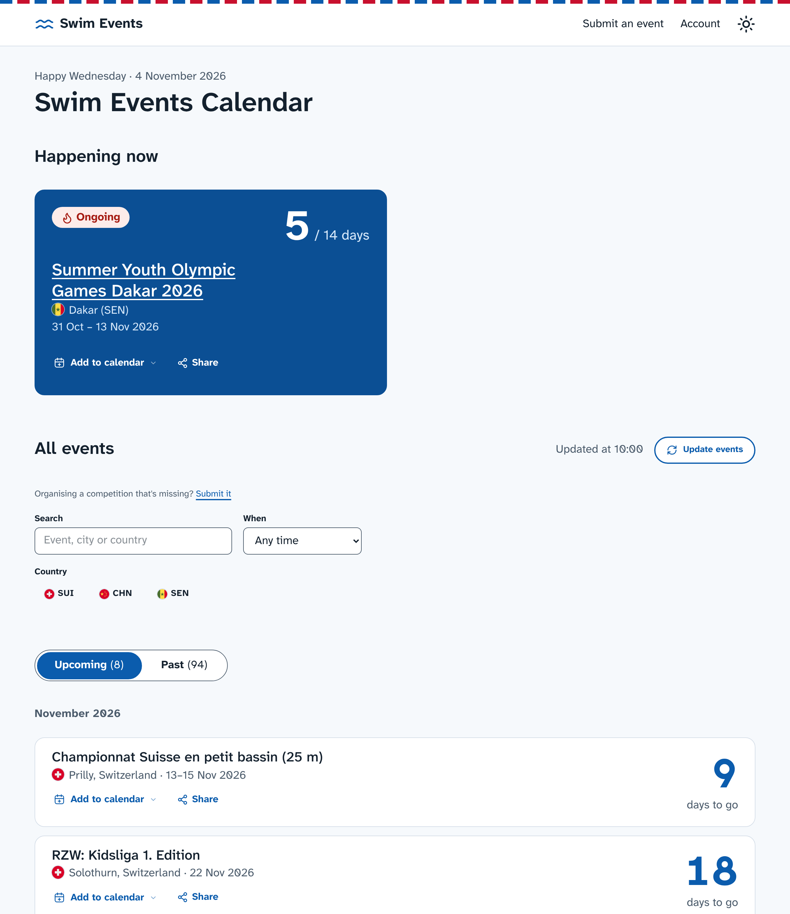
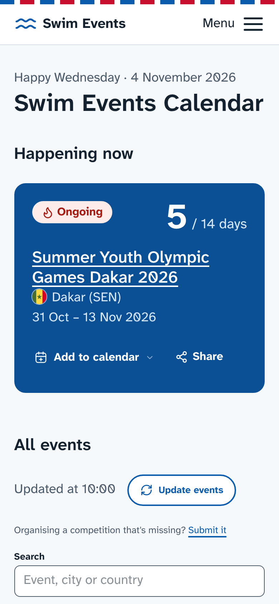
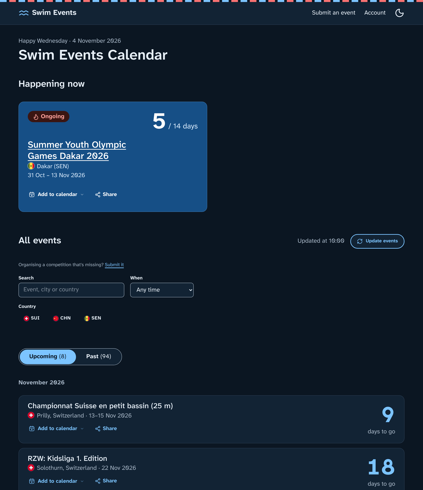

# Swim Events Calendar (v2)

A calendar of swimming competitions in Switzerland and abroad, with a countdown to each one. Visitors can search and
filter the events, add them to their calendar and share them; organisers can submit their own competitions. This is version 2, rebuilt on the
[Accessible Astro Starter](https://github.com/incluud/accessible-astro-starter) (barebones preset). Version 1 (Vue + Parcel)
lives in [CuttingEdgeDevelopment/swim-events](https://github.com/CuttingEdgeDevelopment/swim-events).

### Preview





### Features
- **Countdowns:** the events running today under "Happening now", otherwise the next one under "Next up", then every
  upcoming event by month with the days to go. Past events are listed by year, 20 at a time (10 on phones).
- **Search and filters:** search by event, city or country, pick a time period (next 7 or 30 days, 3 months, or chosen
  dates), countries and, under Past, a year. Filters are kept in the URL (`?q=basel&when=30d&country=SUI&year=2025`), so a
  filtered list can be shared.
- **Add to calendar:** Apple, Google, Outlook, Yahoo or an `.ics` file, using
  [add-to-calendar-button](https://github.com/add2cal/add-to-calendar-button).
- **Share:** opens the device's share sheet, or a menu with Copy link, WhatsApp and Email. The message names the event,
  place, dates and days to go on separate lines, with a calendar call to action, and links to `/#event-123`.
- **Submit an event:** organisers sign in with a one-time code sent by email (no password), submit competitions and see
  their status on the Account page.
- **About, Privacy and Terms** pages, light and dark mode, and accessible keyboard and screen reader support throughout.

### Technologies & Tools
Astro, Tailwind CSS, [Accessible Astro Components](https://github.com/incluud/accessible-astro-components), Supabase
(database, sign-in and Edge Functions), [add-to-calendar-button](https://github.com/add2cal/add-to-calendar-button),
[Resend](https://resend.com/) (emails), [Simple Analytics](https://www.simpleanalytics.com/?referral=bafov)

### How it works
The page is static. In the browser, `src/scripts/events.ts` loads all rows from the Supabase `events` table, then works out
each countdown from the visitor's local date (`src/lib/countdown.ts`). "Update events" fetches them again.

Each event has a `city` and a `country`: the Olympic (IOC) code, e.g. `SUI`, checked against the `countries` table.
Common mix-ups such as `MCO` for Monaco (`MON`) are corrected on save (`supabase/migrations/`). The same codes, names and flags are in `src/lib/countries.ts`; the round flags
in `public/flags/` are copied from [circle-flags](https://github.com/HatScripts/circle-flags) with `npm run flags`.

A shared link such as `/#event-123` opens the home page on that event: it clears filters that would hide it, switches to
the right tab, year and page, then scrolls to the event and outlines it for a moment (`revealSharedEvent` in
`src/scripts/events.ts`). Link previews on WhatsApp, iMessage and others use one image for the whole site,
`src/assets/img/social-preview.png` (1200×630), set in `theme.config.ts`.

### Event submissions
Organisers submit events on `/submit`; each goes into the private `event_submissions` table, protected by row-level
security and checked by database rules (dates, how many submissions an account may have waiting or send per day, set in
`submission_limits`). To review, open `event_submissions` in the Supabase dashboard and set `status` to `approved`,
`rejected` or `spam`. Approving copies the event into `events`, so it shows on the next page load with no rebuild.

A database webhook on `event_submissions` calls the `notify-submission` Edge Function (`supabase/functions/`), which
emails the site owner about new submissions and the organiser about the decision, through Resend. It needs these Edge
Function secrets: `RESEND_API_KEY`, `NOTIFY_EMAIL` (where review emails go) and `WEBHOOK_SECRET` (sent by the webhook in
the `x-webhook-secret` header). The database rules are tested in `supabase/tests/database/`.

### Getting started
Requires Node 24.19 or newer.

1. Create a `.env` file:
   ```
   PUBLIC_SUPABASE_URL=https://<project>.supabase.co
   PUBLIC_SUPABASE_KEY=<publishable / anon key>
   ```
   Both are required; the build fails without them.
2. Run:

| Command           | Action                                      |
| :---------------- | :------------------------------------------ |
| `npm install`     | Installs dependencies                       |
| `npm run dev`     | Starts local dev server at `localhost:4321` |
| `npm run build`   | Builds the production site to `./dist/`     |
| `npm run preview` | Previews the build locally                  |
| `npm run lint`    | Checks the code with ESLint                 |
| `npm run flags`   | Copies the country flags to `public/flags/` |

### Deployment
Netlify builds the site using `netlify.toml`. Set `PUBLIC_SUPABASE_URL` and `PUBLIC_SUPABASE_KEY` in the site's environment
variables.

#### Events check
`.github/workflows/events-check.yml` loads the events once a day (06:00 UTC) the same way the site does. When that fails,
it opens an "Events failed to load" issue assigned to the site owner, comments on it while the problem lasts, and closes it
once events load again. It needs the same `PUBLIC_SUPABASE_URL` and `PUBLIC_SUPABASE_KEY` as repository variables
(Settings → Secrets and variables → Actions → Variables). Run it by hand from the Actions tab to test.

#### Keeping dependencies up to date
- **Packages** (Astro, Tailwind CSS, Accessible Astro Components and the rest): Dependabot (`.github/dependabot.yml`) opens
  pull requests on the 1st and 15th of each month. Minor and patch updates come grouped (Astro, Tailwind, dev tools, everything else); each
  major update comes on its own, so read its upgrade guide before merging. New releases wait a few days (two weeks for
  majors) before they are proposed. Nothing merges automatically.
- **Checks**: `.github/workflows/ci.yml` installs exactly what `package-lock.json` lists, runs the linter (`npm run lint`), `astro check` and builds
  the site on every pull request and push to `main`. Merge an update only when it is green, and look at the Netlify
  deploy preview for anything visual.
- **Accessible Astro Starter**: it is a template we copied, not a package, so Dependabot cannot update it.
  `.accessible-astro-starter-version` records the release we started from, and `.github/workflows/starter-check.yml`
  opens an issue on the 1st of each month when a newer release is out, with a link to the upstream changes to copy over.
- **Node**: `.nvmrc` sets the version for CI; keep `NODE_VERSION` in `netlify.toml` and `engines` in `package.json` in step
  with it.

#### Affiliate Disclosure
***Simple Analytics:*** they give me 50% of the first year's revenue. You as a new customer will get one month of extra trial.

[](https://app.netlify.com/projects/swim-events/deploys)

### License
MIT, see [LICENSE](LICENSE). Built on the Accessible Astro Starter by Incluud, also MIT
([LICENSE.accessible-astro-starter](LICENSE.accessible-astro-starter)). Flags from circle-flags by HatScripts, MIT
([public/flags/LICENSE](public/flags/LICENSE)).
