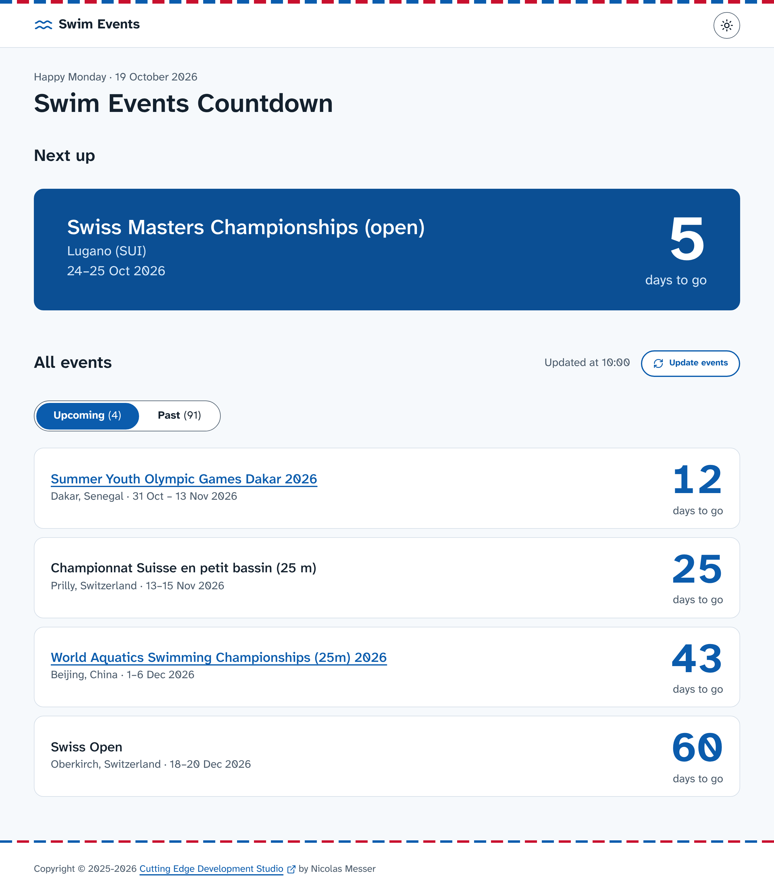
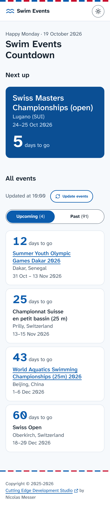
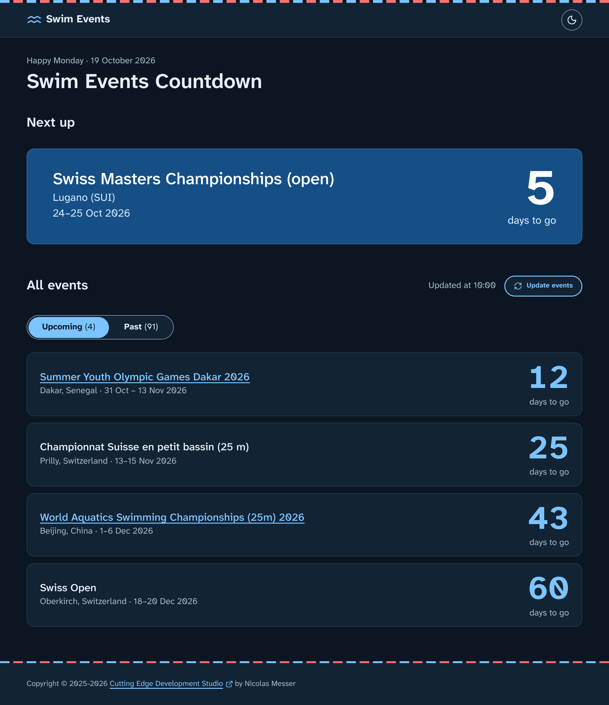

# Swim Events Countdown (v2)

A small site that shows countdowns to upcoming swimming events. This is version 2, rebuilt on the
[Accessible Astro Starter](https://github.com/incluud/accessible-astro-starter) (barebones preset). Version 1 (Vue + Parcel)
lives in [CuttingEdgeDevelopment/swim-events](https://github.com/CuttingEdgeDevelopment/swim-events).

### Preview





### Technologies & Tools
Astro, Tailwind CSS, [Accessible Astro Components](https://github.com/incluud/accessible-astro-components), Supabase,
[Simple Analytics](https://www.simpleanalytics.com/?referral=bafov)

### How it works
The page is static. In the browser, `src/scripts/events.ts` loads all rows from the Supabase `events` table, then works out
each countdown from the visitor's local date (`src/lib/countdown.ts`). "Update events" fetches them again.

### Getting started
Requires Node 24.19 or newer.

1. Create a `.env` file:
   ```
   PUBLIC_SUPABASE_URL=https://<project>.supabase.co
   PUBLIC_SUPABASE_KEY=<publishable / anon key>
   ```
   Both are required; the build fails without them.
2. Run:

| Command           | Action                                      |
| :---------------- | :------------------------------------------ |
| `npm install`     | Installs dependencies                       |
| `npm run dev`     | Starts local dev server at `localhost:4321` |
| `npm run build`   | Builds the production site to `./dist/`     |
| `npm run preview` | Previews the build locally                  |

### Deployment
Netlify builds the site using `netlify.toml`. Set `PUBLIC_SUPABASE_URL` and `PUBLIC_SUPABASE_KEY` in the site's environment
variables.

#### Affiliate Disclosure
***Simple Analytics:*** they give me 50% of the first year's revenue. You as a new customer will get one month of extra trial.

[](https://app.netlify.com/projects/swim-events/deploys)

### License
MIT, see [LICENSE](LICENSE). Built on the Accessible Astro Starter by Incluud, also MIT
([LICENSE.accessible-astro-starter](LICENSE.accessible-astro-starter)).
